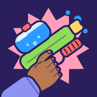
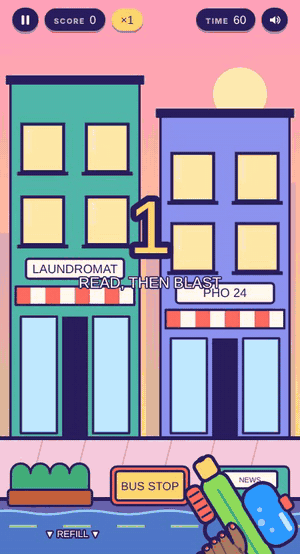
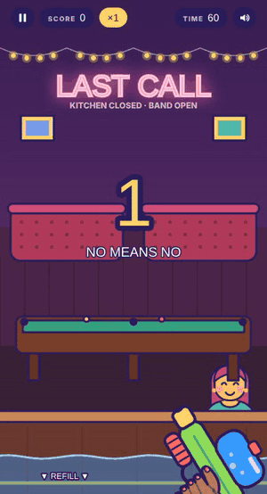
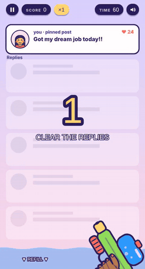

<p align="center"></p>

<h1 align="center">Boundary Blaster</h1>

<p align="center"><b>Read what they say. Soak the creeps. Spare everyone being normal.</b><br>
A feminist arcade game about street harassment, built from scratch for the web and iPhone.</p>

<p align="center"><a href="https://boundaryblaster.com"><b>Play it at boundaryblaster.com</b></a></p>

<p align="center">



</p>

---

## What it is

Boundary Blaster is a Big Buck Hunter–style shooting gallery where the targets are things people actually
say. Every character pops up with a speech bubble. Some are creeps ("Smile, sweetheart!", "That skirt is
too short, hon"), and some are just people being normal ("Which way to the train?"). You read fast, aim a
water blaster, and soak the creeps. They turn into pigeons, launch into orbit, or get sent to mandatory HR
training. Soak someone who was being normal and you lose points and hear a sad trombone.

It's funny on purpose. The goal is the feeling of finally answering back, plus a lot of quick practice at
telling harassment apart from normal behavior.

- **5 levels, 5 bosses:** Main Street, a construction site, a bar at last call, an office party, and the
  comment section, each with its own boss (the Corner Regular, the Foreman, Mr. Nice Guy, the Regional
  Manager and the Reply Guy)
- **"Heard it IRL":** players submit lines that were really said to them. Once a person approves a line,
  it goes into the game for everyone to blast, credited to the submitter or kept anonymous.
- **Accounts and leaderboards:** profiles, stars, best scores, a daily challenge, and IRL leaderboards
  (whose real-life lines got blasted most)
- **Your hand, your look:** pick your skin tone and nail polish for the hand on the blaster
- **iPhone app:** the same game, packaged natively and in a TestFlight beta

## Design decisions I'm proud of

**It's about patriarchy, not just men.** About one in five people who pop up is a woman repeating
internalized misogyny ("She only got promoted for her looks"), and normal women show up too. You can't
win by shooting a type of person. You have to read what they say.

**Looks can't be the tell.** In the office level and in Unhinged Mode, creeps dress and smile exactly like
everyone else. Every character moves (wandering the bar, swaying in windows, pacing the scaffolding), and
nice people move the same way, so movement never gives anyone away.

**Bosses that teach a pattern.** Mr. Nice Guy acts sweet with a halo and flowers, then the mask slips at a
random moment, and sometimes he leaves without slipping at all. You can't park your aim and wait. You have
to recognize the turn.

**Playful, never violent.** Water, pigeons and parking tickets, no weapons. The blaster went through
several redesigns after playtest feedback so it reads as a toy, not anything else.

**Accessible difficulty.** Easy, Normal and Hard change pace, crowding and movement speed, and an automated
test player runs through every level and boss on each one.

## Privacy and safety by design

A game that invites people to share harassment they've experienced has to be careful with that trust.

- **Guests store nothing on a server.** Progress stays on the device until someone chooses to make an account.
- **Moderated submissions.** Every "Heard it IRL" line is reviewed by a person. A filter blocks phone
  numbers, links and handles. Anonymous submitters are never exposed: the public can only read the
  approved text, place and chosen credit, never who sent it.
- **Real account deletion.** One button deletes the account, profile and scores. Lines a player submitted
  stay in the game but lose their credit and any link to the player.
- **Bot protection** on sign-in with Cloudflare Turnstile, sign-in by one-time email code (no passwords
  to leak), and a strict Content Security Policy on the site.
- **Server-side checks.** Scores are submitted through a database function that rejects impossible
  results, and row-level security means players can only ever touch their own data.

## How it's built

| Part | Tech |
|---|---|
| Game | Plain JavaScript and HTML5 Canvas, no game engine or framework; hand-drawn vector characters rendered in code |
| Backend | Supabase (Postgres with row-level security, column-level grants, security-definer functions, email one-time codes) |
| Email | Resend over SMTP from the game's own domain |
| Hosting | Netlify, with security headers and subresource integrity |
| iPhone | Capacitor native wrapper; built, signed and uploaded to TestFlight by a GitHub Actions workflow on a cloud Mac |
| Testing | Playwright: an automated player that plays through every level and boss on each difficulty, plus end-to-end tests of sign-in, leaderboards, submissions and account deletion against a mocked backend |

A small taste of the game logic: keeping women creeps at about 1 in 5 of everyone who pops up, even on
levels with extra pop-ups that are always men, by leaning the odds while a round is behind or ahead:

```js
const femChance = (bad, prog) => {
  if (!LV.femBad) return 0;
  if (!bad) return 0.2;                                   // some normal people are women too
  const behind = FEM_SHARE * stats.pops - stats.femCreeps; // how far this round is from 1 in 5
  return clamp(FEM_SHARE / LV.badRatio(prog) + behind * 0.18, 0.05, 0.85);
};
```

## Status

The web game is live at [boundaryblaster.com](https://boundaryblaster.com). The iPhone version is in a
TestFlight beta with friends. Next up: a supporter pack of cosmetics, and a private "say it back" mode for
lines too personal to share.

---

Built by Aliya Wark · [hello@boundaryblaster.com](mailto:hello@boundaryblaster.com)

**© 2026 Boundary Blaster. All rights reserved.** This repository is a showcase; the game's source code
is private. The screenshots, artwork and text here may not be reused without permission.
